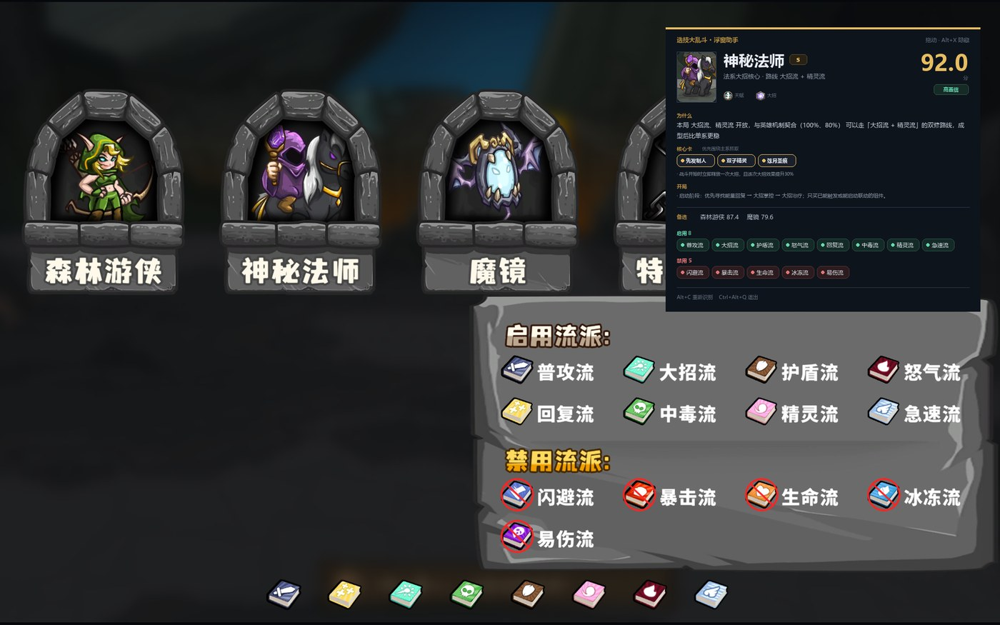

# 选技大乱斗 · 浮窗助手

进入选人界面后自动识别 3 个候选英雄、8 个启用流派和 5 个禁用流派，在游戏右侧浮窗给出首选英雄、核心卡和开局路线；不需要按键，也不需要 API Key。手动 `Alt+C` 可强制重识别。

## 3 步开始

1. 双击 `启动助手.bat`，屏幕上出现「浮窗已就绪」卡片。
2. 把游戏设为「无边框全屏」或窗口化，进入开局选人界面。
3. 等 3 个英雄名牌和底部 8 个书包图标稳定出现，浮窗会自动给出推荐；想立即重算可按 `Alt+C`。

快捷键被占用会自动换，以控制台和浮窗显示的为准。`Alt+X` 隐藏/显示，`Ctrl+Alt+Q` 退出。

> 独占全屏会黑屏或盖不住浮窗，这是 Windows 限制；改成无边框窗口即可。

## 亮点

- **进入界面自动识别**，无需按键；自动失败时 `Alt+C` 可手动强制一次。
- **60 个英雄、156 张卡牌、13 个流派**，英雄图鉴、卡牌库、规则速查都可离线查。
- **60 篇英雄构筑攻略**，每篇含主副流派、抓牌顺序、克制关系和候选卡池。
- **浮窗常驻、置顶、可拖动**，记住上次位置，不抢游戏焦点。
- **正式英雄立绘 + 天赋/大招图标**，浮窗、结果卡和图鉴统一使用。
- **完全本地运行**，不配置任何模型也能用；AI 点评是可选项。
- 支持手动修正英雄/流派；字库缺字时可补字模。

## 核心功能

### 浮窗

识别后显示本局首选、评分、两条核心理由、核心卡、开局路线和备选。按住卡片任意位置拖动，松手后自动保存位置。按 `Alt+X` 可完全让开游戏画面。

### 英雄图鉴

打开 `http://127.0.0.1:8777/library`，或点网页右上角「图鉴」。

英雄图鉴包含 60 个英雄的面板、天赋、大招、推荐流派、核心卡和克制关系；卡牌库支持按名称、效果、流派、稀有度筛选；规则页可速查属性、经济和 13 流派机制。

### 网页控制台

双击 `打开设置.bat` 打开当前端口。可以编辑攻略、上传截图手动修正、学习新英雄头像，以及配置可选的 AI 点评。

### 攻略库

攻略是 `data/guides/` 下的 Markdown 文件，也可以直接在网页里编辑。保存后下一次识别立即生效，不需要重启。

## 常见问题

**没有自动出结果？**
先确认底部 8 个书包图标和顶部前 3 个英雄名牌都完整出现；自动识别用这两处，不需要右下角 13 流派面板。想立即重算按 `Alt+C`；如果还是不动，看控制台是否显示「自动识别已开启」和实际抓帧方式。详见 [TROUBLESHOOTING](docs/TROUBLESHOOTING.md)。

**浮窗黑屏或不显示？**  
九成是游戏用了独占全屏，改成「无边框窗口」或窗口模式。详见 [TROUBLESHOOTING](docs/TROUBLESHOOTING.md)。

**浮窗挡住游戏？**  
按住卡片拖到角落，或按隐藏键。详见 [TROUBLESHOOTING](docs/TROUBLESHOOTING.md)。

**遇到没见过的英雄？**  
先看浮窗是否显示某个槽位未识别；自动识别用闭集字库，不会乱猜。可以在网页版上传截图手动修正。详见 [USER_GUIDE](docs/USER_GUIDE.md)。

**端口被占用？**  
助手会自动顺延到后面的端口，以控制台或 `data/server_url.txt` 的实际地址为准。详见 [TROUBLESHOOTING](docs/TROUBLESHOOTING.md)。

## 更多文档

| 文档 | 内容 |
| --- | --- |
| [INSTALL](docs/INSTALL.md) | 依赖、安装、启动器、快捷键参数 |
| [USER_GUIDE](docs/USER_GUIDE.md) | 浮窗操作、图鉴、网页控制台、手动修正 |
| [TROUBLESHOOTING](docs/TROUBLESHOOTING.md) | 启动、识别、显示、性能、端口问题 |
| [ARCHITECTURE](docs/ARCHITECTURE.md) | 架构、线程、截图、识别、已知限制 |
| [live-perf](docs/live-perf.md) | 实时识别性能实测与回放夹具 |
| [SCORING_AND_RAG](docs/SCORING_AND_RAG.md) | 攻略库、检索、评分、AI 点评 |
| [DEVELOPMENT](docs/DEVELOPMENT.md) | 命令行、测试、数据重建 |
| [ROADMAP](docs/ROADMAP.md) | 后续可以扩展的方向 |
| [DATA_SOURCES](docs/DATA_SOURCES.md) | 数据表、图片素材、社区来源与致谢 |

### 攻略知识库

- [全英雄构筑速查](docs/全英雄构筑速查.md)
- [网站版与浮窗助手版完整教程](docs/网站版与浮窗助手版完整教程.md)
- [攻略知识库维护说明](docs/攻略知识库维护README.md)
- [规则与数据核对](docs/规则与数据核对.md)
- [社区来源与版本差异](docs/社区来源与版本差异.md)

## 免责

本项目是非官方的个人辅助工具，与游戏开发商无关。英雄强度、流派契合度和评分是整理后的示例数据，不是官方胜率；实际对局请结合开放流派、已有卡牌、宝物和对手调整。
