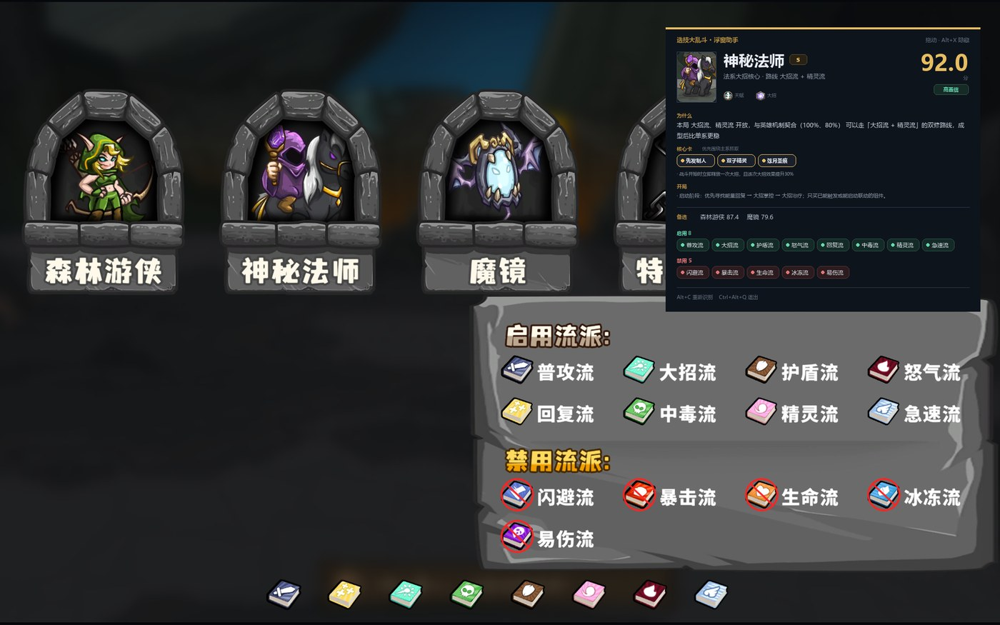

# 选技大乱斗 · 浮窗助手

进入选人界面后自动识别顶部实际出现的 1~5 个候选英雄、8 个启用流派和 5 个禁用流派，在游戏右侧浮窗给出每个英雄的评分、核心卡和开局路线；默认不需要按键，也不需要 API Key。手动 `Alt+C` 可强制重识别。

## 3 步开始

1. 双击 `启动助手.bat`，选择 `1`，屏幕上出现「浮窗已就绪」卡片。
2. 把游戏设为「无边框全屏」或窗口化，进入开局选人界面。
3. 等英雄名牌和底部 8 个书包图标稳定出现，浮窗会自动给出推荐；想立即重算可按 `Alt+C`。

快捷键被占用会自动换，以控制台和浮窗显示的为准。`Alt+X` 隐藏/显示，`Alt+D` 调试浮层，
`Ctrl+Alt+Q` 退出。

> 独占全屏会黑屏或盖不住浮窗，这是 Windows 限制；改成无边框窗口即可。

## 下载免安装版

不想装 Python 时，从 [GitHub Releases](https://github.com/garcey6/Skill-Legends-Helper/releases/latest) 下载 `XuanJiHelper-*-windows-x64.zip`，解压后双击 `XuanJiHelper.exe`；同目录的 `.sha256` 用于校验。仅支持 Windows x64，exe 未签名，首次运行可能触发 SmartScreen 或杀软误报，是否放行请自行判断。构建细节见 [RELEASE](docs/RELEASE.md)。

## 亮点

- **进入界面自动识别**，无需按键；英雄名用本地 RapidOCR + 60 人闭集校正，失败回退字模。
- **流派识别不需要右侧面板**：底部 8 个书包图标色度 + 白色符文决胜，禁用 5 个用全集减法。
- **60 个英雄、156 张卡牌、13 个流派**，英雄图鉴、卡牌库、规则速查都可离线查。
- **60 篇英雄构筑攻略**，每篇含主副流派、抓牌顺序、克制关系和候选卡池。
- **浮窗常驻、置顶、可拖动**，记住上次位置，不抢游戏焦点。
- **正式英雄立绘 + 天赋/大招图标**，浮窗、结果卡和图鉴统一使用。
- **完全本地运行**，不配置任何模型也能用；AI 点评是可选项。
- 支持手动修正英雄/流派；字库缺字时可补字模。

## 核心功能

### 浮窗

识别后每个英雄一个完整区块：评分、定位/路线、两条核心理由、核心卡、开局路线；英雄多时卡片自动加高，超过屏幕高度可滚轮查看。按住卡片任意位置拖动，松手后自动保存位置。按 `Alt+X` 可完全让开游戏画面。

### 英雄图鉴

打开 `http://127.0.0.1:8777/library`，或点网页右上角「图鉴」。

英雄图鉴包含 60 个英雄的面板、天赋、大招、推荐流派、核心卡和克制关系；卡牌库支持按名称、效果、流派、稀有度筛选；规则页可速查属性、经济和 13 流派机制。

### 网页控制台

双击 `启动助手.bat`，选择 `3` 打开当前端口。可以编辑攻略、上传截图手动修正、学习新英雄头像，以及配置可选的 AI 点评。

### 攻略库

攻略是 `data/guides/` 下的 Markdown 文件，也可以直接在网页里编辑。保存后下一次识别立即生效，不需要重启。网页编辑需要程序目录可写；如果解压到 `Program Files` 等受保护目录，请改放到免安装目录再编辑。

## 常见问题

**没有自动出结果？**
先确认底部 8 个书包图标和顶部英雄名牌都完整出现；自动识别用这两处，不需要右下角 13 流派面板。想立即重算按 `Alt+C`；如果还是不动，看控制台是否显示「自动识别已开启」和实际抓帧方式。注意：如果只有英雄变化、8 个启用流派没变，自动层可能沿用上一条结果，按 `Alt+C` 可强制重算。详见 [TROUBLESHOOTING](docs/TROUBLESHOOTING.md)。

**浮窗黑屏或不显示？**  
九成是游戏用了独占全屏，改成「无边框窗口」或窗口模式。详见 [TROUBLESHOOTING](docs/TROUBLESHOOTING.md)。

**浮窗挡住游戏？**  
按住卡片拖到角落，或按隐藏键。详见 [TROUBLESHOOTING](docs/TROUBLESHOOTING.md)。

**遇到没见过的英雄？**  
先看浮窗是否显示某个槽位未识别；自动识别用闭集字库，不会乱猜。可以在网页版上传截图手动修正。详见 [USER_GUIDE](docs/USER_GUIDE.md)。

**端口被占用？**  
助手会自动顺延到后面的端口，以控制台或 `data/server_url.txt` 的实际地址为准。详见 [TROUBLESHOOTING](docs/TROUBLESHOOTING.md)。

## 项目文档

### 项目基建

| 文档 | 内容 |
| --- | --- |
| [PRD](PRD.md) | 产品定位、系统推荐与用户预设的边界、非目标、验收口径 |
| [RULES](RULES.md) | 开发流程、验证顺序、文档分档、“未核验”规则 |
| [ARCHITECTURE](ARCHITECTURE.md) | 运行架构、线程、数据/资产契约、模板分组、已知限制 |
| [DEVELOPMENT_LOG](DEVELOPMENT_LOG.md) | 根因与正确做法，避免重复踩坑 |
| [PLAN](PLAN.md) | 四阶段计划、真实帧门槛阶梯、未闭环债务 |
| [ADR](ADR.md) | 已接受的架构决策与待决项 |
| [AGENTS](AGENTS.md) | 给 AI/协作者的最小入口、命令、八荣八耻 |

### 更多文档

| 文档 | 内容 |
| --- | --- |
| [INSTALL](docs/INSTALL.md) | 依赖、安装、启动器、快捷键参数 |
| [USER_GUIDE](docs/USER_GUIDE.md) | 浮窗操作、图鉴、网页控制台、手动修正 |
| [TROUBLESHOOTING](docs/TROUBLESHOOTING.md) | 启动、识别、显示、性能、端口问题 |
| [live-perf](docs/live-perf.md) | 实时识别性能实测与回放夹具 |
| [SCORING_AND_RAG](docs/SCORING_AND_RAG.md) | 攻略库、检索、评分、AI 点评 |
| [DEVELOPMENT](docs/DEVELOPMENT.md) | 命令行、测试、数据重建 |
| [HOLDOUT](docs/HOLDOUT.md) | 真实帧采集、导入与准确率门槛 |
| [RELEASE](docs/RELEASE.md) | 构建免安装发行包 |
| [ROADMAP](docs/ROADMAP.md) | 后续可以扩展的方向 |
| [DATA_SOURCES](docs/DATA_SOURCES.md) | 数据表、图片素材、社区来源与致谢 |

### 攻略知识库

- [全英雄构筑速查](docs/全英雄构筑速查.md)
- [网站版与浮窗助手版完整教程](docs/网站版与浮窗助手版完整教程.md)
- [攻略知识库维护说明](docs/攻略知识库维护README.md)
- [规则与数据核对](docs/规则与数据核对.md)
- [社区来源与版本差异](docs/社区来源与版本差异.md)

## 免责与风险

本项目是非官方的个人辅助工具，与游戏开发商无关。英雄强度、流派契合度和评分是整理后的示例数据，不是官方胜率；实际对局请结合开放流派、已有卡牌、宝物和对手调整。

本项目只读取屏幕像素，不读取或修改游戏内存、文件，也不模拟键鼠操作；但**独占全屏、受保护画面或反作弊渲染可能让截图失败**，部分游戏的用户协议也可能限制第三方辅助工具。请先阅读 [使用风险与合规说明](docs/RISK.md)，自行确认所在地区与游戏规则是否允许，并自行承担账号与社区规则风险。

本项目以 [MIT License](LICENSE) 开源；按“现状”提供，不附带任何担保。
