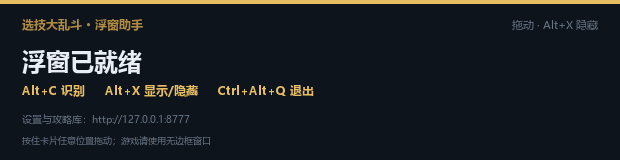

# 使用指南

本文覆盖浮窗操作、英雄图鉴、网页控制台、手动修正和攻略库。安装和参数见 [INSTALL](INSTALL.md)，故障排查见 [TROUBLESHOOTING](TROUBLESHOOTING.md)。

## 启动与就绪卡

双击 `启动助手.bat`。控制台会打印实际快捷键和网页地址，屏幕右侧出现「浮窗已就绪」卡片。待机卡会常驻，不会自动消失。



按住卡片任意位置即可拖动，松手后位置写入 `data/overlay_position.json`；下次启动和下次识别会回到这里。删掉该文件可恢复默认位置。

## 快捷键

| 按键 | 作用 |
| --- | --- |
| `Alt+C` | 强制重新识别当前画面（正常不需要按） |
| `Alt+X` | 显示 / 隐藏浮窗 |
| `Ctrl+Alt+Q` | 退出助手 |

快捷键被占用时会自动换键，常见回退是 `F6` 识别、`F7` 隐藏、`Ctrl+Shift+Q` 退出。**实际按键以控制台第一屏和待机卡为准。** 自定义方法见 [INSTALL](INSTALL.md#命令行参数)。

## 游戏内使用

1. 推荐「无边框全屏」或窗口化；独占全屏既盖不住浮窗，也可能抓不到画面。
2. 进入开局选人界面，确保顶部前 3 个英雄名牌和**底部 8 个书包图标**稳定出现。新方案用「8 个启用图标 + 前 3 个名牌」，不需要右下角 13 流派面板，也不检测红色禁环。
3. 等画面稳定，浮窗会**自动**出现结果，不需要按键；想立即重算可按 `Alt+C`。
4. 选完人按 `Alt+X` 隐藏；再按一次回到上次位置。

结果卡包含：

- 首选英雄、评分、置信度和两条核心理由；
- **核心卡**：前 3 张卡名、稀有度颜色和第一张卡效果；
- 开局路线；
- 备选英雄和分数；
- 本局 8 启用 / 5 禁用流派对照。

浮窗是只读的，不能在浮窗上改英雄或流派；修正请用网页控制台。

## 英雄图鉴 / 卡牌库 / 规则

打开：

```text
http://127.0.0.1:8777/library
```

如果控制台显示的是其他端口，以实际端口为准。也可以点网页右上角「图鉴」。

- **英雄图鉴**：60 个英雄，可按强度、评级、名称排序，按流派筛选。详情包含基础面板、天赋、大招、推荐流派契合度、6 张核心卡、克制关系和已有攻略。
- **卡牌库**：156 张卡牌，按名称/效果搜索，按流派和稀有度筛选；展示双流派、卡池数量和完整效果。
- **规则速查**：基础属性、经济/利息、13 流派机制。


图鉴里的 60 张英雄立绘和 120 张天赋/大招图标只用于显示，不参与自动识别。

## 网页控制台

双击 `打开设置.bat` 打开当前端口。


网页控制台可以：

- **攻略库**：选择英雄，编辑 Markdown 正文，保存后立即重建索引；下一次识别生效，不用重启。
- **手动上传截图**：拖入或粘贴完整选人界面，网页版会走同一套识别和推荐。
- **修正英雄/流派**：识别错时在英雄下拉框和流派标签上修正；有有效头像裁切时会尝试记住新英雄。
- **AI 点评**：可选配置 OpenAI 兼容接口；不配置也能正常用。浮窗本身不调用模型。

只想用网页版、不启动浮窗时，双击 `启动网页版.bat`。网页版和浮窗可以同时开。

## 手动修正与学习新英雄

自动识别改为**闭集字库**：60 个英雄名共 155 个不同汉字，每个字用 16×16 字模匹配，名牌序列必须整名命中；不认识的英雄返回 `null`，不会瞎猜。

`data/art` 里的 300×300 立绘只用于显示，不参与识别；识别读 `data/recognize/glyphs.json` 的字模和 `layout.json` 的两个 ROI。

如果某个英雄槽位长期为空：
1. 按 `Alt+X` 隐藏浮窗。
2. 双击 `打开设置.bat`，上传同一张截图，在对应槽位手动选对英雄。
3. 若名字中某个字不在字库，按控制台/网页提示补字模；补完后下一次识别生效。

识别是闭集：置信度不足会留空并提示，不会把“最像”的英雄当成答案。

## 没有开游戏时测试

先启动助手，再运行：

```powershell
python tools/preview_draft.py 30
```

它会全屏显示内置示例画面，窗口标题模拟游戏。等几秒，浮窗应自动出现结果（无需按键）；30 秒后自动关闭，按 Esc 可提前关闭。

## 攻略库

项目已内置 60 篇英雄构筑攻略，位于 `data/guides/`。可以直接在网页攻略库编辑，也可以放 Markdown 文件：

```text
data/guides/<英雄名>.md
```

`hero` 字段必须和 `data/heroes.json` 的 `name` 一致；`##` 二级标题会切成检索块。保存后下一次识别自动加载。

完整攻略、卡池依据和维护方式见：

- [全英雄构筑速查](全英雄构筑速查.md)
- [网站版与浮窗助手版完整教程](网站版与浮窗助手版完整教程.md)
- [攻略知识库维护说明](攻略知识库维护README.md)

## 数据与隐私

- 默认只监听 `127.0.0.1`，截图只在内存和 `data/captures/last.png` 中处理。
- 唯一的外部请求是主动开启的 AI 点评。
- `data/settings.json` 可能包含可选的 API Key，已被 `.gitignore` 排除，不会提交。
- 英雄强度、流派契合度和评分是示例整理数据，不是官方胜率。
